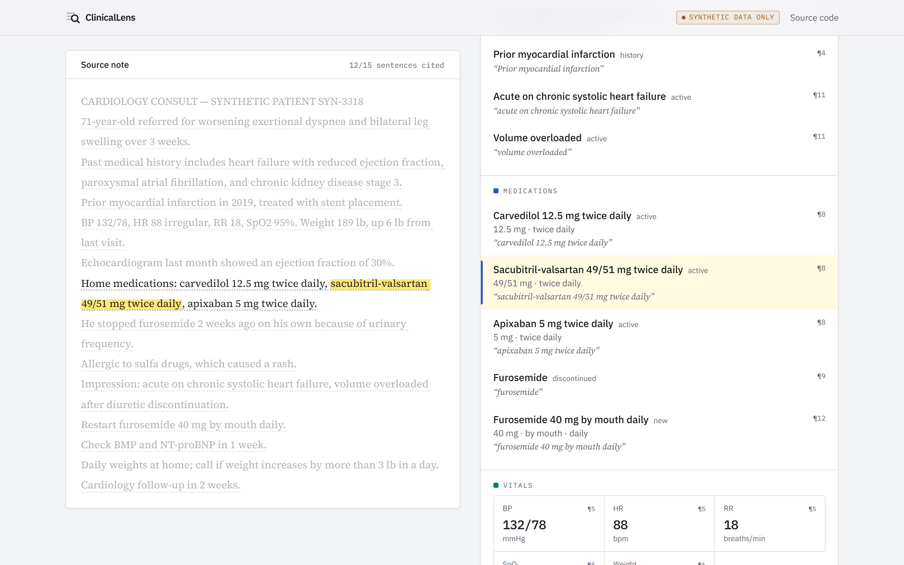
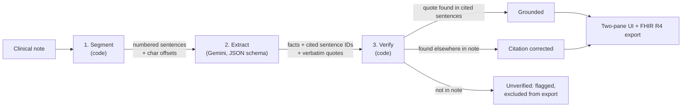
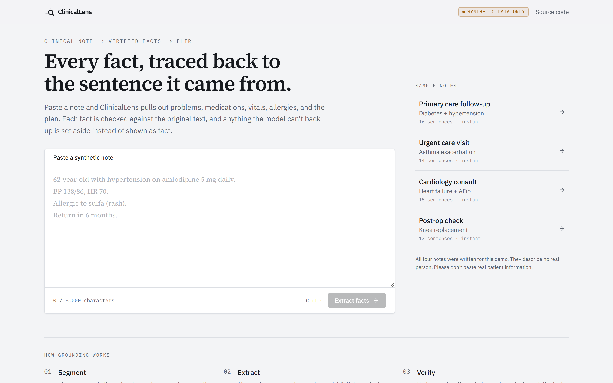
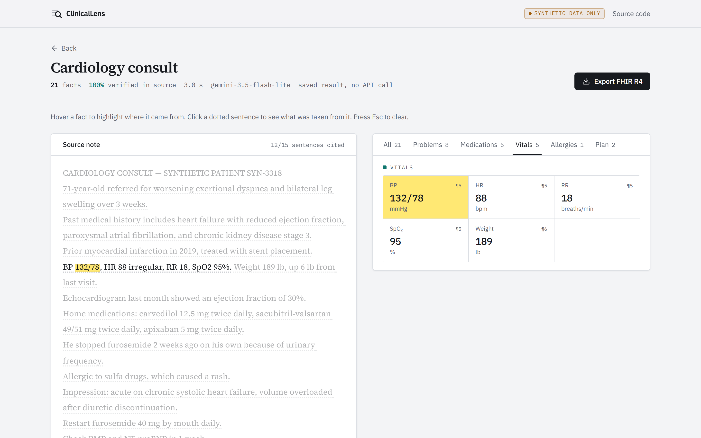
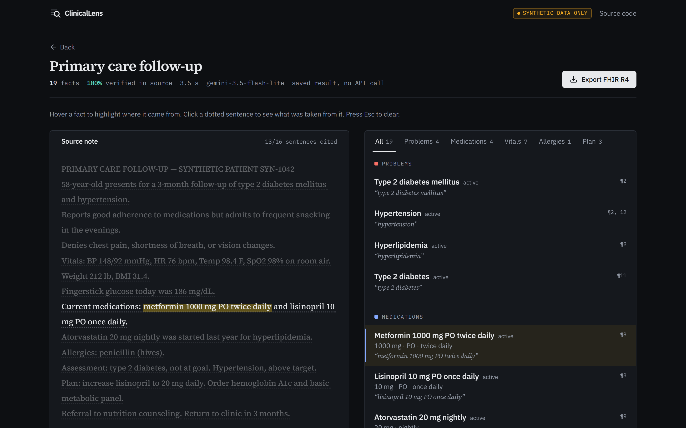
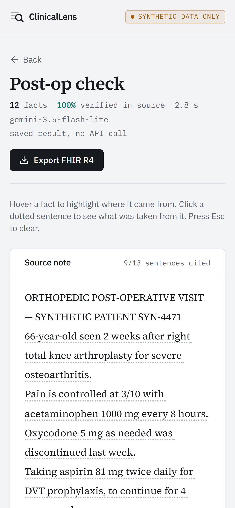

# ClinicalLens

**Grounded extraction for clinical notes.** Paste a note and get a structured summary of problems, medications, vitals, allergies, and the plan. Every fact links back to the exact words it came from, and anything the model can't back up is flagged instead of shown as fact. The result exports as a FHIR R4 Bundle.

> **Synthetic data only.** Every note in this repo and demo was written for it and describes no real person. Don't paste real patient information.

**Eval:** 96.9% precision / 96.9% recall on a hand-labeled set ([results](eval/RESULTS.md)) · light and dark themes · responsive



## Why

LLMs are good at reading clinical text and bad at telling you when they made something up. Most "AI summary" demos show model output and ask you to trust it. ClinicalLens treats the model's output as a **claim** and checks it with ordinary code before showing it: if a fact can't be found word for word in the note, it isn't presented as a fact.

## How grounding works



1. **Segment** ([`lib/segment.ts`](lib/segment.ts)). The server splits the note into sentences with exact character offsets. It's deterministic and handles clinical text: line-oriented sections, decimals (`98.6`), and abbreviations (`b.i.d.`, `Dr.`).
2. **Extract** ([`lib/llm/`](lib/llm/)). The model sees numbered sentences (`[S7] Current medications: ...`) and must return JSON matching a Zod schema. Each fact includes the sentence IDs it relies on and a **verbatim quote**. The response is re-validated with Zod; model output is never trusted blindly.
3. **Verify** ([`lib/ground.ts`](lib/ground.ts)). Code searches for each quote (tolerating case, whitespace, and smart-quote differences) inside the cited sentences, maps it back to an exact character span, and assigns a status:
   - **Grounded:** found where the model said it was.
   - **Citation corrected:** found verbatim, but in a different sentence than cited. The link is fixed.
   - **Unverified:** not in the note at all. Shown separately with a strike-through, never treated as fact, and left out of the export.

The UI then links both directions: hover a fact to sweep a highlighter over its exact source words, or click a sentence to see every fact taken from it.

## Evaluation

The **eval set** ([`eval/cases.ts`](eval/cases.ts)) is 10 synthetic notes across primary care, urgent care, cardiology, orthopedics, pediatrics, psychiatry, prenatal care, the ED, pulmonology, and dermatology. Every expected fact was labeled by hand. Some notes include deliberate negation traps that must *not* come back as diagnoses, such as "denies suicidal ideation", "pneumonia was ruled out", and "negative tuberculosis test".

| Category | Precision | Recall | F1 |
|---|---|---|---|
| Problems | 85.7% | 100.0% | 92.3% |
| Medications | 100.0% | 100.0% | 100.0% |
| Vitals | 100.0% | 100.0% | 100.0% |
| Allergies | 100.0% | 100.0% | 100.0% |
| Plan | 100.0% | 81.8% | 90.0% |
| **Overall** | **96.9%** | **96.9%** | **96.9%** |

- **143/143** facts verified verbatim in their source note.
- **0 of 12** negation traps extracted as diagnoses.
- **2.5 s** median model latency.

**What the misses show** (full list in [`eval/RESULTS.md`](eval/RESULTS.md)):
- **Plan recall:** the model sometimes merges two orders from one sentence ("Order hemoglobin A1c and basic metabolic panel") into a single fact.
- **Problem precision:** near-duplicates with different wording ("type 2 diabetes" and "type 2 diabetes mellitus") both appear. Exact duplicates are merged in code; synonym merging would need terminology mapping (see Limitations).

I deliberately didn't tune the prompt against these cases, so the numbers stay an honest held-out measurement. Scoring ([`eval/score.ts`](eval/score.ts)) uses one-to-one alias matching per category. It counts only *verified* facts, and optional labels (symptoms, repeat readings) are neither rewarded nor penalized. Run it with `npm run eval`.

## Engineering notes

- **Model choice, measured.** On the free tier, `gemini-3.8-flash` took **80–240 s per note**. A benchmark ([`scripts/bench.ts`](scripts/bench.ts)) showed `gemini-3.5-flash-lite` with minimal thinking at **~3 s**, still with every fact verified, so it's the default. Extraction is lookup, not reasoning. The model and thinking level are env-configurable, and the provider sits behind a small interface ([`lib/llm/types.ts`](lib/llm/types.ts)), so swapping in another model is one file.
- **A prompt fix that made things worse.** Telling the model "never list an item twice" removed duplicates, but it also silently dropped real diagnoses. I reverted it and moved deduplication into deterministic code.
- **Zero-cost demo path.** The bundled samples are run once through the real pipeline (`npm run precompute`) and served from saved results. Only pasted notes call the API.
- **Abuse protection.** Notes are capped at 8,000 characters and oversized bodies are rejected before parsing. Upstash rate limits apply per IP and globally per day, and they fail open if Redis is down. Transient model failures are retried once; quota errors are not.
- **Client robustness.** Leaving the loading screen aborts the request, so a late response can't pull you back. Non-JSON gateway errors become readable messages. On touch devices, hover preview is disabled so selections can't get stuck.
- **FHIR R4 export** ([`lib/fhir.ts`](lib/fhir.ts)) maps facts to `Condition`, `MedicationStatement`, `Observation`, and `AllergyIntolerance`:
  - vitals use LOINC codes (blood pressure is split into systolic/diastolic components)
  - references use `urn:uuid`
  - the Patient is tagged as test data
  - only verified facts are exported

## Screenshots

| Home | Vitals linked to source |
|---|---|
|  |  |

| Dark mode | Mobile |
|---|---|
|  |  |

## Tech stack

Next.js 16 (App Router) · TypeScript · Tailwind CSS v4 · Motion · Google Gemini API (`@google/genai`, structured JSON output) · Zod · Upstash Redis · Vitest · Vercel

## Run locally

```bash
npm install
cp .env.example .env.local   # add a free Gemini API key from Google AI Studio
npm run dev                  # http://localhost:3000
```

| Script | What it does |
|---|---|
| `npm test` | Unit tests: segmentation, grounding, dedupe, FHIR mapping, eval scoring |
| `npm run eval` | Runs the eval set against the live model and rewrites `eval/RESULTS.md` |
| `npm run precompute` | Regenerates saved results for the bundled samples |
| `npx tsx --env-file=.env.local scripts/bench.ts cardiology` | Latency/grounding check for one sample |

Rate limiting is optional locally; without Upstash env vars it's skipped with a warning.

## Project structure

```
app/api/extract/route.ts   POST endpoint: validate, rate limit, segment, extract, verify
lib/segment.ts             sentence splitter with exact offsets
lib/ground.ts              quote verification, citation correction, dedupe
lib/llm/                   provider interface, Gemini implementation, prompt
lib/fhir.ts                FHIR R4 Bundle builder
components/                two-pane UI, linked highlighting, loader
eval/                      hand-labeled cases, scorer, RESULTS.md
data/                      synthetic sample notes + precomputed results
```

## Limitations

- **Verbatim grounding proves a quote exists, not that the interpretation is right.** A correctly quoted "lisinopril 10 mg" could still get the wrong status. The eval measures interpretation; grounding measures fabrication.
- **No terminology coding yet.** Conditions and medications export as text. Mapping to SNOMED CT / RxNorm would enable synonym merging and coded FHIR.
- **Small eval set.** 10 notes and 128 labeled facts is enough to catch regressions, not to make clinical claims.
- **Free-tier model.** Google may use free-tier prompts to improve its products, which is acceptable here only because all data is synthetic.

Not for clinical use.

---

Built by Anubhav Utkarsh.
